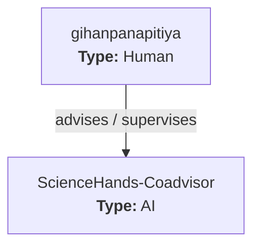

# Team Roles and Responsibilities

<!-- Generated from team.json. Do not edit by hand. -->

Member ids in the table link to their cards below — or click a node in the org chart above — for a person's details.

## Team directory

| ID | GitHub | Identity class | Type | Advisors | Branch | Issues |
|---|---|---|---|---|---|---|
| [ScienceHands-Coadvisor](#sciencehands-coadvisor) | [@sciencehands](https://github.com/sciencehands) |  | AI | gihanpanapitiya |  |  |
| [gihanpanapitiya](#gihanpanapitiya) | [@gihanpanapitiya](https://github.com/gihanpanapitiya) |  | Human |  |  |  |

## Team members

### ScienceHands-Coadvisor

<b>AI</b>

- **ID:** `ScienceHands-Coadvisor`
- **Type:** AI
- **GitHub:** [@sciencehands](https://github.com/sciencehands)
- **Advisors:** [gihanpanapitiya](#gihanpanapitiya)
- **Direct reports:** —

**Plan**

- **Branch:** —
- **Issues:** —

**Expertise & limits**

- **Consult on:** Team coordination, hypothesis framing, research planning
- **Known limitations:** Cannot run experiments or make final decisions without human sign-off

### gihanpanapitiya

<b>Human</b>

- **ID:** `gihanpanapitiya`
- **Type:** Human
- **GitHub:** [@gihanpanapitiya](https://github.com/gihanpanapitiya)
- **Advisors:** —
- **Direct reports:** [ScienceHands-Coadvisor](#sciencehands-coadvisor)

**Plan**

- **Branch:** —
- **Issues:** —

**Expertise & limits**

- **Consult on:** —
- **Known limitations:** —

